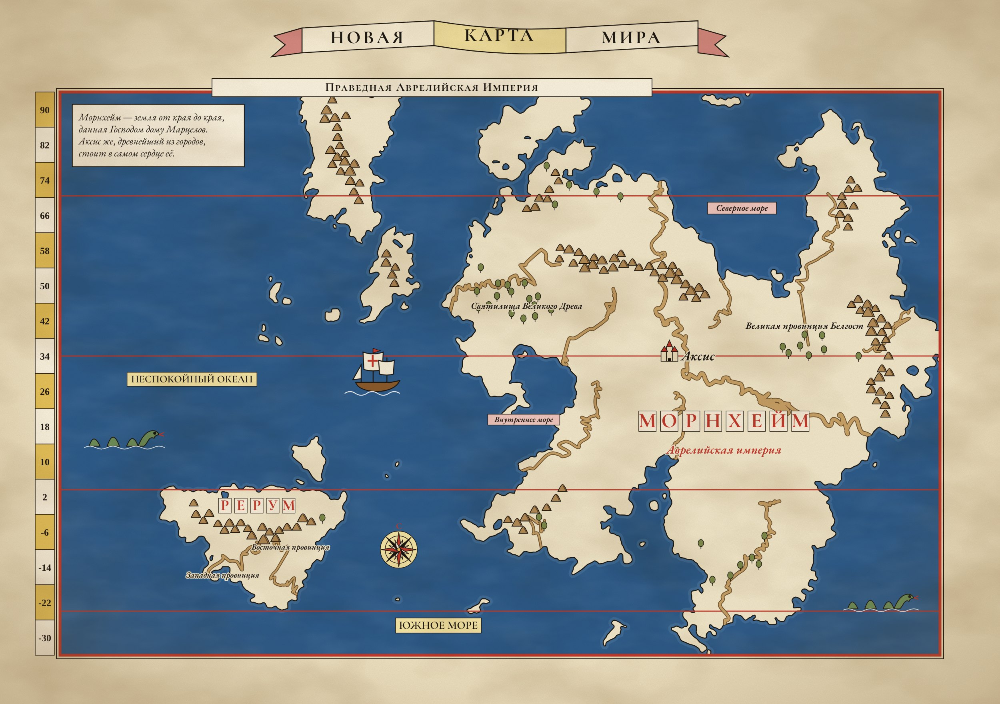

# Мир

*655 год нашей эры*

Нынешние времена не самые радужные... То хворь всякая гуляет, то монстры совершают набеги на деревни и города, то злые духи шутят свои шутки с честным людом. Райских уголков не найти ни одному народу. Войны со всеми их неприятными последствиями и нехватка ресурсов заставили многих покинуть уютные дома в поисках новой крыши над головой — места, где они нашли бы себя в этом мире. Тысячи искателей приключений, молодых и не очень, проповедников и послушников своих богов, головорезов и даже самых обычных людей искали такие места. И одним из них стал для них [Рерум](istoriya.md#drevnie-vremena).

## Морнхейм и Рерум

**Морнхейм** — Большая земля, сердце [Аврелийской империи](sily.md#imperiya). Вся она от края до края живёт под рукой дома Марцелов.

**Рерум** — остров, лежащий далеко от Большой земли. Империя взялась за него всерьёз лишь в 623 году, и к нынешнему дню он поделён на две провинции — Западную и Восточную.

*Нажми на карту, чтобы открыть её в полном размере.*

Как велось счисление лет и что происходило в мире до наших дней — смотри [Летоисчисление](#letoischislenie).

## 📅 Летоисчисление {#letoischislenie}

Годы в Империи отсчитываются от **Взятия Аксиса** — дня, с которого, по словам [Праведного Завета](zavet.md), «начинается Завет». Это нулевой год. Всё, что было прежде, — годы **до Завета**.

### Морнхейм

| Год | Событие |
| --- | --- |
| ~1000 до Завета и ранее | Господство Республики тифлингов над Морнхеймом |
| 0 | Явление Архонда Аврелию Марцелу. Начало мятежа. Взятие Аксиса |
| ~1 | Предательство в пещерах. Смерть Аврелия. Проклятие и рождение монгреллов. Воскрешение |
| ~1 | Явление Благодати. Первые исцеления |
| 1–25 | Священная война |
| 25 | Падение Республики. Основание Морнхеймской империи. Священный Пакт |
| 25 | Смерть Аврелия I. С ним уходит полная Благодать |
| 25– | Правление Августа I. Покорение всего Морнхейма |
| ~30 | Переименование державы в Аврелийскую империю |
| ~30 | Учреждение Кровных домов и закона о Даре Крови |
| 25 — наши дни | Правление дома Марцелов (более шестисот лет) |
| ныне | Эпоха колоний за морями |

### Рерум

| Год | Событие |
| --- | --- |
| задолго до Завета | Племена расселяются по Реруму, бок о бок с монстрами |
| ~III–IV века | Возвышение Разаласа Тексере. Первые люди Империи Марцелов на Реруме, основание поселения Мордвейнцев. Люди с Востока прибывают на остров |
| ~150 лет спустя | Упадок клана Камакура. Война кланов, сёгунат Сугавара |
| начало VII века | Шахтёры Мордвейнцев находят залежи золота и железа. Указ императора Карла II о присоединении острова |
| 623 | Высадка имперских войск. Начало покорения Рерума |
| 623–655 | Война с Восточными кланами и мирное соглашение. Усмирение племён |
| 655 | Наши дни |

> Даты событий на Реруме приблизительные: летописей там почти не вели, и многое известно лишь по легендам.
